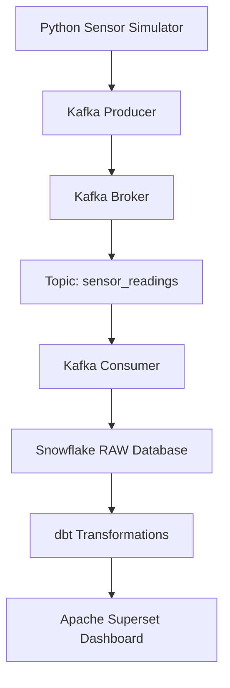

# AtmoSync System Architecture

## Architecture Diagram

## Overview

AtmoSync is a real-time IoT data pipeline designed to monitor avocado storage containers.

## Working Process

1. Python Simulator generates simulated sensor readings.
2. Kafka Producer sends readings to Kafka.
3. Kafka Broker receives and manages the messages.
4. The sensor_readings topic organizes the messages.
5. Kafka Consumer reads the sensor data.
6. Snowflake stores the incoming raw sensor data.
7. dbt cleans and transforms the data.
8. Apache Superset displays the processed data through dashboards.

## Technologies Used

- Python
- Apache Kafka
- Snowflake
- dbt
- Apache Superset
  
