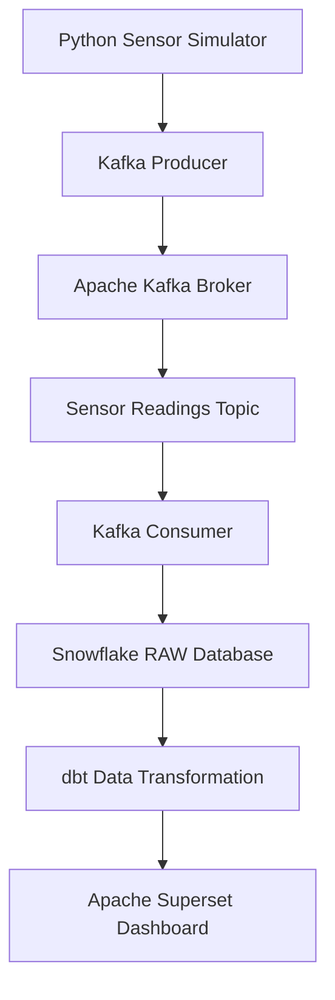

# AtmoSync – System Architecture

## 1. Project Overview
AtmoSync is an IoT-based data monitoring and analytics system designed to monitor avocado storage conditions using simulated sensor readings.

## 2. System Workflow

## 3. Component Description

1. **Python Sensor Simulator:** Generates temperature, humidity and vibration readings.
2. **Kafka Producer:** Sends sensor readings to Kafka.
3. **Apache Kafka:** Receives and manages real-time sensor messages.
4. **Kafka Consumer:** Reads messages from the Kafka topic.
5. **Snowflake:** Stores the incoming sensor data.
6. **dbt:** Transforms raw data into structured datasets.
7. **Apache Superset:** Displays processed data through dashboards.

## 4. Expected Outcome
The system provides a continuous data pipeline for monitoring storage conditions and visualizing sensor readings through dashboards.
