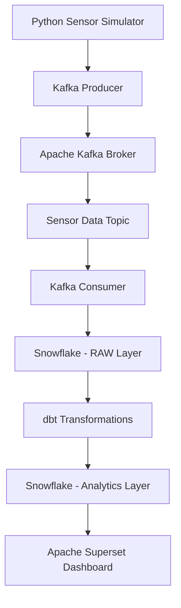

# AtmoSync – System Architecture

## 1. Project Overview

AtmoSync is an IoT-based monitoring and analytics system designed to monitor environmental conditions inside avocado storage containers.

The system collects sensor data such as temperature, humidity, and vibration, processes it through a real-time data pipeline, stores it for analysis, and presents meaningful insights through interactive dashboards.

## 2. System Objectives

- Monitor environmental conditions inside storage containers.
- Collect temperature, humidity, and vibration readings.
- Enable real-time sensor data streaming.
- Store and transform sensor data efficiently.
- Identify environmental variations through analytics.
- Provide interactive dashboards for monitoring and decision-making.

## 3. System Architecture Diagram

The AtmoSync architecture follows a streaming-based data pipeline.



## 4. Architecture Components

### 4.1 IoT Sensors / Python Sensor Simulator
- Generates simulated sensor readings.
- Collects temperature, humidity, and vibration values.
- Produces structured JSON records.
- Represents the IoT data source.

### 4.2 Apache Kafka Producer
- Receives generated sensor readings.
- Publishes messages to Kafka topics.
- Transfers sensor data to the streaming platform.

### 4.3 Apache Kafka Broker
- Manages incoming messages.
- Stores and distributes records.
- Supports communication between producers and consumers.

### 4.4 Kafka Topic
- Organizes incoming sensor messages.
- Provides a communication channel for sensor data.
- Example topic: `sensor_data`.

### 4.5 Kafka Consumer
- Subscribes to the sensor data topic.
- Reads incoming sensor messages.
- Forwards records to the Snowflake data pipeline.

### 4.6 Snowflake
- Stores incoming sensor records in the RAW layer.
- Provides scalable cloud data storage.
- Supports analytical queries.

### 4.7 dbt (Data Build Tool)
- Performs SQL-based data transformations.
- Organizes and cleans sensor data.
- Creates structured analytical models.

### 4.8 Apache Superset
- Connects to the analytical data layer.
- Creates interactive dashboards.
- Displays environmental monitoring insights.

## 5. End-to-End Data Flow

1. Sensors or the Python simulator generate environmental readings.
2. The Kafka Producer publishes readings to the Kafka platform.
3. Kafka Broker manages the incoming messages.
4. Sensor readings are organized in the `sensor_data` topic.
5. Kafka Consumer retrieves the messages.
6. The consumer forwards records to Snowflake.
7. dbt transforms the raw sensor records into analytical models.
8. Apache Superset visualizes the processed data through dashboards.

## 6. Sensor Data Structure

The system uses a common JSON format for exchanging sensor readings.

Example:

```json
{
  "container_id": "AVO_001",
  "sensor_id": "SEN_01",
  "timestamp": "2026-11-15T10:30:00Z",
  "temperature": 8.5,
  "humidity": 75.2,
  "vibration": 0.35
}
```

## 7. Technology Stack

| Component | Technology |
|---|---|
| Programming Language | Python |
| Data Streaming | Apache Kafka |
| Data Storage | Snowflake |
| Data Transformation | dbt |
| Data Visualization | Apache Superset |
| Data Format | JSON |
| Version Control | Git and GitHub |

## 8. Team Responsibilities

| Team Member | Responsibility |
|---|---|
| Shrawani | Team Lead and Data Engineering Integration |
| Harshit Doijad | Python Sensor Simulator |
| Shaikh MD Ashraf | Snowflake and dbt |
| Pragyansh Gaur | Apache Superset and Dashboards |

## 9. Expected Outcome

AtmoSync aims to provide a unified IoT data monitoring system that collects, streams, stores, transforms, and visualizes environmental sensor readings.

The architecture supports modular development and integration of individual components into a complete data engineering pipeline.
